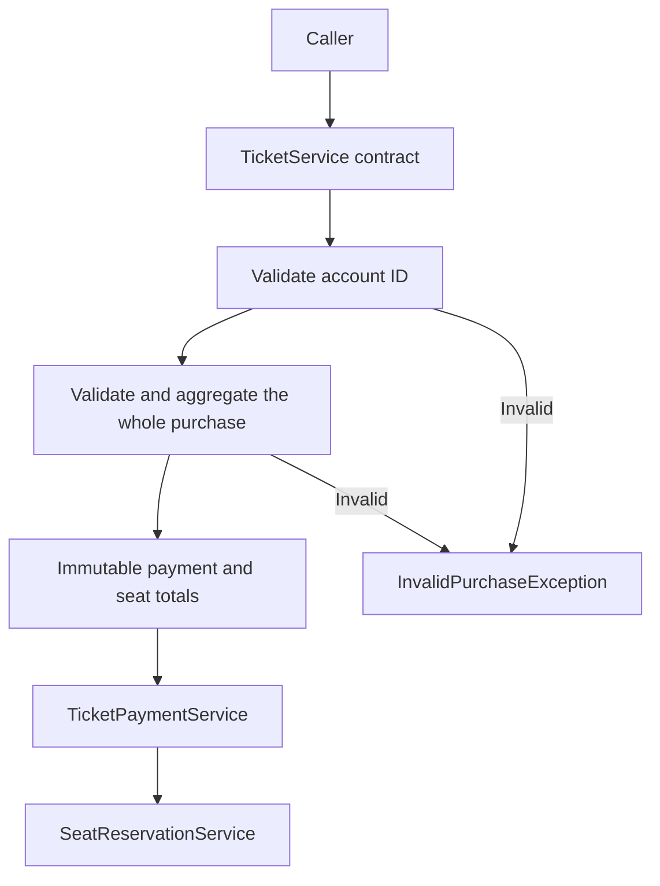

# Ticket service design

## Scope and boundaries

The service accepts ticket quantities for an account, enforces purchase rules and instructs existing payment and seat providers. Its contract returns no purchase receipt. Provider success and sufficient account funds are supplied assumptions.

The diagram shows call order. No provider is called unless validation completes. A successful call makes one request to each provider. This sequence is not an atomic transaction spanning both providers.

## Implementation decisions

| Decision | Reason and trade-off |
| --- | --- |
| Small public orchestration method | The entry point makes the sequence of validation, calculation and external calls immediately visible. |
| Private validation and calculation helpers | The rules can be followed without provider interactions in the same method. A separate service hierarchy would add little value at this size. |
| Private immutable `PurchaseTotals` record | Names the two derived values and passes them together after validation. It is an implementation detail, not a new public contract. |
| Constructor-supplied interfaces | Dependencies are explicit and tests can replace the providers. The no-argument constructor remains compatible with the starter and connects the supplied placeholders. |
| Immutable `TicketTypeRequest` | Callers cannot mutate a request object or subclass it to change its observable state. The caller still owns the containing array and must not modify it concurrently. |
| Local counters | Calls do not share purchase totals. Thread safety of injected providers remains their responsibility. |
| Whole-purchase adult check | An adult may appear anywhere in the request list. Repeated types are aggregated, and each purchase must independently satisfy the rule. |
| Check remaining capacity before addition | Extremely large positive quantities cannot wrap the running ticket count. |
| Integer prices | Current prices are whole pounds and a valid total cannot exceed £625. Fractional pricing or multiple currencies would require an explicit monetary representation and rounding policy. |
| Validation at the purchase boundary | All invalid purchase inputs produce the supplied exception type. An immutable request can carry invalid values until the service validates it; immutability and validity are different properties. |

The algorithm makes a single pass and uses constant additional storage. Positive quantities and the limit bound a successful purchase to at most 25 request entries; an over-limit request is rejected early. There is no need to sort requests or allocate a collection in production code.

## Requirements decisions

Infants count towards the ticket cap but not payment or seats. The implemented accompaniment rule requires an adult in the same purchase. The specification gives no numerical infant-to-adult ratio, so a one-infant-per-adult limit has not been introduced.

Each request entry must have a positive quantity. A type that is not wanted is omitted. Null arrays, empty purchases, null entries, missing types, invalid account IDs, non-positive quantities and excessive totals are rejected.

These are explicit interpretations. The tests establish consistency with them; they cannot determine an unstated assessor expectation.

## Verification strategy

Tests assert externally visible outcomes through the unchanged public interface. Mockito tests name normal, boundary and malformed cases and verify forbidden interactions. Recording-provider tests check the bounded combination matrix and changes in input ordering and grouping. Regression tests cover reuse of the service across successful and rejected purchases.

The private helpers and record are not called directly by tests. That lets their structure change while the tests continue to enforce the public behaviour. Coverage measures exercised code; it is not a proof of correct requirements interpretation or an account of whether development followed TDD.

## How a production design would differ

The following are discussion topics, not implemented features or additional assessment requirements. First establish traffic, latency targets, acceptable downtime, data retention, security boundaries and how failed purchases should be resolved.

| New requirement or failure | Design question to resolve |
| --- | --- |
| Caller retries after a timeout | How is one purchase identified across retries, and can every side-effecting provider recognise the same idempotency key? |
| Payment succeeds but reservation fails | Can funds be authorised before capture, can seats be held, and which compensation actions do providers support? |
| Provider response is lost | How can the operation's outcome be queried and reconciled before attempting another charge or booking? |
| Two callers want the final seat | Which reservation authority performs the atomic availability check and allocation? A local Java counter cannot enforce this across callers or replicas. |
| Process stops midway | Which durable purchase state records completed operations, and what component resumes or reconciles incomplete work? |
| Provider latency rises | What timeout budget, retry eligibility and load protection preserve the agreed service objectives? |
| Operators need diagnosis | Which correlation identifiers, metrics and audit events identify incomplete purchases while avoiding sensitive data in logs? |
| Expose purchases over HTTP | How are callers authorised to use an account, errors represented, request limits enforced and API versions evolved? A positive account number alone is not authentication. |

The current interfaces expose only an account and an amount or seat count. They provide no purchase ID, status query, seat hold, refund or cancellation operation. Reliable recovery would require additional capabilities agreed with those providers. Adding retries or a database transaction around the current calls would not by itself make the external operations atomic.

These concerns may fit within a modular application; separate deployable services should follow a demonstrated need for ownership, scaling or operational isolation. The present exercise does not establish such a need.
